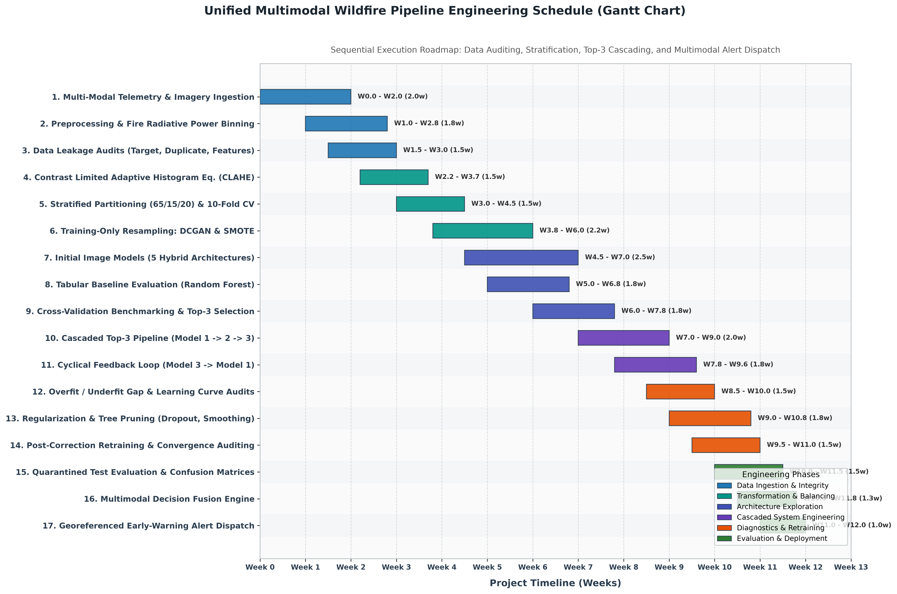
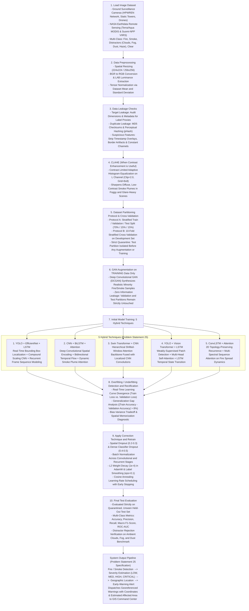
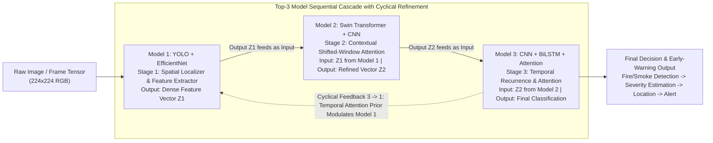

# Multi-Modal Spatial-Temporal Framework for Early Wildfire and Smoke Detection

### Problem Statement 25 • VIT Tech-a-thon
**School of Computer Science Engineering and Information Systems**

---

## Interactive Google Colab Notebooks

All pipelines are directly executable in Google Colab with preconfigured dependencies and self-contained execution flows:

| Pipeline | Google Colab Interactive Notebook | Execution Sequence |
| :--- | :---: | :--- |
| **Unified Multimodal Pipeline (Master)** | [](https://colab.research.google.com/github/ssreeakash-cpu/AI-Hackathon/blob/main/notebooks/Unified_Multimodal_Pipeline_Colab.ipynb) | **Merged Dual-Branch Workflow**: Multi-Modality Ingestion $\to$ Leakage Audits $\to$ CLAHE / Scaling $\to$ Splits/10-Fold CV $\to$ **DCGAN & SMOTE (Train only)** $\to$ Dual Baseline Training $\to$ Overfit Diagnosis $\to$ Regularization Retrain $\to$ Dual Test Evaluation $\to$ **Multimodal Late-Fusion Decision Dispatch** |
| **Image Classification Pipeline** | [](https://colab.research.google.com/github/ssreeakash-cpu/AI-Hackathon/blob/main/notebooks/Image_Classification_Pipeline_Colab.ipynb) | Image Ingestion $\to$ Preprocessing $\to$ Leakage Audits $\to$ **CLAHE** $\to$ Stratified Splits/10-Fold CV $\to$ **DCGAN Augmentation (Train partition only)** $\to$ Initial CNN $\to$ Overfit Diagnosis $\to$ **Dropout/BatchNorm/WeightDecay Regularization** $\to$ Isolated Test Evaluation |
| **CSV / Tabular Telemetry Pipeline** | [](https://colab.research.google.com/github/ssreeakash-cpu/AI-Hackathon/blob/main/notebooks/CSV_Tabular_Classification_Pipeline_Colab.ipynb) | CSV Ingestion $\to$ Preprocessing $\to$ Leakage Audits $\to$ Stratified Splits/10-Fold CV $\to$ **SMOTE Resampling (Train partition only)** $\to$ Initial Random Forest $\to$ Overfit Diagnosis $\to$ **Structural Tree Pruning & Gradient Boosting Retrain** $\to$ Isolated Test Evaluation |

---

## Project Engineering Roadmap & Lifecycle Schedule (Gantt Chart)

The implementation and validation of the multimodal wildfire detection system is governed by a 12-week structured engineering lifecycle spanning data leakage auditing, contrast transformation, stratified cross-validation, 5 hybrid architectures, Top-3 cascading, and multimodal alert dispatch.



### 12-Week Methodology Schedule Breakdown

| Phase | Engineering Stage | Timeline | Key Tasks & Technical Deliverables |
| :--- | :--- | :---: | :--- |
| **Phase 1** | **Data Ingestion & Integrity** | Weeks 1 – 2.5 | Multi-sensor telemetry loading (NASA VIIRS/MODIS CSV, camera & drone imagery), target formulation, target leakage correlation checks (\|r\| < 0.90), MD5 duplicate hash audits, zero-variance feature elimination. |
| **Phase 2** | **Feature Transformation & Stratification** | Weeks 2.5 – 5.0 | Contrast Limited Adaptive Histogram Equalization (CLAHE) on image luminance, stratified train/val/test partitioning (65% / 15% / 20%), 10-fold CV configuration, DCGAN image augmentation (training partition only), SMOTE tabular resampling (training partition only). |
| **Phase 3** | **Model Architecture Exploration** | Weeks 4.5 – 7.5 | Evaluation of 5 Hybrid Deep Learning Techniques (YOLO+EfficientNet+LSTM, CNN+BiLSTM+Attention, Swin+CNN, YOLO+ViT+LSTM, ConvLSTM+Attention), unconstrained Random Forest baseline for tabular telemetry, 10-fold CV benchmarking. |
| **Phase 4** | **Cascaded System Engineering** | Weeks 7.0 – 9.5 | Sequential cascading of top 3 models: Model 1 (spatial) $\to$ Model 2 (contextual shifted-window attention) $\to$ Model 3 (temporal recurrence), integration of cyclical feedback loop (3 $\to$ 1 attention modulation prior). |
| **Phase 5** | **Diagnostics & Regularization** | Weeks 8.5 – 11.0 | Overfitting and underfitting generalization gap analysis, structural decision tree pruning (max_depth=5), spatial/dense dropout (0.4), label smoothing (0.1), L2 weight decay, and regularized retraining. |
| **Phase 6** | **Evaluation & Multimodal Deployment** | Weeks 10.0 – 12.0 | Isolated quarantined test set evaluation, multimodal decision late-fusion engine (visual confidence + satellite FRP), automated georeferenced alert dispatch to incident commanders. |

---

## Image Classification Pipeline & 5 Hybrid Techniques Architecture

As formulated in VIT Tech-a-thon Problem Statement 25 ("AI-Based Early Detection of Forest Fire and Smoke from Satellite / Camera Images"), the visual detection stream combines spatial feature extraction with temporal sequence modeling to distinguish true wildfire events from atmospheric distractors (clouds, fog, dust).


### Exact Image Classification Sequence Flowchart



### 5 Hybrid Techniques Overview

| Hybrid Technique | Architecture Components | Primary Role in System |
| :--- | :--- | :--- |
| **1. YOLO + EfficientNet + LSTM** | Real-time object detector + Compound scaling CNN + Recurrent unit | Ground surveillance camera feeds: localizes active flame and smoke plumes, passing deep spatial feature embeddings to LSTM for sequence tracking |
| **2. CNN + BiLSTM + Attention** | Deep convolutional spatial encoder + Bidirectional LSTM + Attention gate | Early smoke plume recognition: captures subtle temporal motion changes bidirectionally while attention weights highlight diffuse plume edges |
| **3. Swin Transformer + CNN** | Shifted window self-attention backbone + Localized convolutional blocks | Hierarchical multi-scale representation: handles variable smoke density across high-resolution satellite remote sensing imagery |
| **4. YOLO + Vision Transformer + LSTM** | Patch-based detector + ViT multi-head attention + Sequence model | Weakly supervised spatiotemporal modeling: extracts attention across image tiles, tracking spatial growth without requiring dense pixel-level masks |
| **5. ConvLSTM + Attention** | 2D topology-preserving spatial recurrence + Temporal attention | 10-day multi-spectral satellite NetCDF datacubes: preserves 2D geographic topology while predicting wildfire spread velocity and perimeter expansion |

### Top-3 Cascaded Pipeline Architecture (1 -> 2 -> 3 with 3 -> 1 Feedback)

The top three deep learning architectures are integrated into a sequential and cyclical feature-refinement pipeline:



* **Model 1 $\rightarrow$ Model 2**: Model 1 (YOLO + EfficientNet) extracts localized spatial activations from raw camera and satellite frames, projecting candidate regions into feature embedding $Z_1 \in \mathbb{R}^{128}$. This output vector $Z_1$ is fed directly as the input sequence to Model 2.
* **Model 2 $\rightarrow$ Model 3**: Model 2 (Swin Transformer + CNN) applies multi-head shifted-window self-attention across tokens derived from $Z_1$, separating diffuse smoke textures from lookalike clouds and fog, producing refined representation $Z_2 \in \mathbb{R}^{128}$. This output is fed directly into Model 3.
* **Model 3 $\rightarrow$ Final Output**: Model 3 (CNN + BiLSTM + Attention) models temporal forward and backward sequence dynamics over $Z_2$, using attention weights to emphasize frames with rapid plume expansion and outputting final multi-class probabilities and severity.
* **Cyclical Feedback ($3 \rightarrow 1$)**: High-level temporal context from Model 3 ($3 \rightarrow 1$) is fed back as an auxiliary prior to Model 1, dynamically gating spatial receptive sensitivity for a refined second evaluation pass ($3 \rightarrow 1 \rightarrow 2 \rightarrow 3$).

---

## Unified Dual-Branch Methodology and System Architecture

The system coordinates visual observation from remote sensors and ground cameras with real-time satellite telemetry, synchronizing both data modalities through a structured 10-stage processing and validation pipeline.


### Merged Modality Workflow

```mermaid
graph TD
    subgraph S1["1. Data Ingestion"]
        IMG_LOAD["Load Image Dataset<br/>Ground & Satellite Imagery"]
        CSV_LOAD["Load CSV Telemetry<br/>NASA VIIRS / MODIS Active Fire"]
    end

    subgraph S2["2. Data Preprocessing"]
        IMG_PRE["Image Standardization<br/>224x224 RGB, Tensor Normalization"]
        CSV_PRE["Tabular Imputation<br/>Missing Value Median, Target Formulation"]
    end

    IMG_LOAD --> IMG_PRE
    CSV_LOAD --> CSV_PRE

    subgraph S3["3. Rigorous Data Leakage Checks"]
        LEAK["Leakage Verification Audits:<br/>1. Target Leakage (Ground Truth Feature Proxy Audit)<br/>2. Duplicate Leakage (MD5 & Perceptual Hash Check)<br/>3. Suspicious Feature & Zero-Variance Column Elimination"]
    end

    IMG_PRE --> LEAK
    CSV_PRE --> LEAK

    subgraph S4["4. Domain Feature Transformation"]
        CLAHE["CLAHE Processing<br/>Contrast Limited Adaptive Histogram Equalization"]
        SCALE["Feature Scaling<br/>StandardScaler fit strictly on training set"]
    end

    LEAK --> CLAHE
    LEAK --> SCALE

    subgraph S5["5. Dataset Partitioning Protocol"]
        SPLIT["1. Stratified Train / Validation / Test Split (70% / 15% / 15%)<br/>2. 10-Fold Stratified Cross-Validation (K=10)"]
    end

    CLAHE --> SPLIT
    SCALE --> SPLIT

    subgraph S6["6. Training-Only Class Balancing"]
        GAN["GAN Augmentation (Train Only)<br/>DCGAN Synthesizes Fire/Smoke Minorities<br/>Val/Test Quarantined"]
        SMOTE["SMOTE Balancing (Train Only)<br/>Synthesizes Minority Feature Vectors<br/>Val/Test Quarantined"]
    end

    SPLIT -->|Image Train Split| GAN
    SPLIT -->|CSV Train Split| SMOTE

    subgraph S7["7. Initial Model Training"]
        IMG_INIT["Baseline Vision Network<br/>Convolutional Feature Extractor"]
        CSV_INIT["Baseline Tabular Classifier<br/>Unconstrained Random Forest Ensemble"]
    end

    GAN --> IMG_INIT
    SMOTE --> CSV_INIT

    subgraph S8["8. Overfitting / Underfitting Diagnosis"]
        DIAG["Diagnostic Auditing:<br/>- Trajectory Divergence (Train vs. Validation Loss)<br/>- Generalization Gap (|Train Acc - Val Acc| > Threshold)<br/>- Bias-Variance Tradeoff Analysis"]
    end

    IMG_INIT --> DIAG
    CSV_INIT --> DIAG

    subgraph S9["9. Correction Techniques & Retraining"]
        IMG_CORR["Vision Regularization Retrain:<br/>- Spatial Dropout (p=0.2) & Dense Dropout (p=0.4)<br/>- Batch Normalization across Convolutions<br/>- Weight Decay (L2 = 1e-4) & Label Smoothing"]
        CSV_CORR["Tabular Regularization Retrain:<br/>- Structural Tree Pruning (max_depth=5)<br/>- Node Constraints (min_samples_leaf=4)<br/>- Regularized Gradient Boosting with Shrinkage"]
    end

    DIAG -->|Image Stream| IMG_CORR
    DIAG -->|Tabular Stream| CSV_CORR

    subgraph S10["10. Final Test Evaluation"]
        IMG_EVAL["Final Vision Evaluation<br/>Held-Out Test Set: Accuracy, Precision, Recall, F1"]
        CSV_EVAL["Final Tabular Evaluation<br/>Held-Out Test Set: Balanced Accuracy, ROC-AUC, F1"]
    end

    IMG_CORR --> IMG_EVAL
    CSV_CORR --> CSV_EVAL

    subgraph S11["11. Multimodal Decision Fusion"]
        FUSION["Late-Fusion Early-Warning Engine<br/>- Calibrated Risk Scoring & Severity Gating<br/>- Georeferenced Alert Dispatch to GIS Console"]
    end

    IMG_EVAL --> FUSION
    CSV_EVAL --> FUSION
```



### Stage-by-Stage Methodological Alignment

| Stage | Branch A: Image Modality Stream | Branch B: CSV Tabular Modality Stream | Methodological Principle |
| :--- | :--- | :--- | :--- |
| **1. Data Ingestion** | Discovers multi-class camera imagery (`Fire`, `Smoke`, `Clouds_Fog`, `Clear`) | Ingests NASA VIIRS 375m and MODIS 1km active fire CSV records | Verified cataloging of raw sensor feeds |
| **2. Preprocessing** | Validates dimensions, converts BGR $\to$ RGB, resizes to uniform geometry | Imputes missing entries, encodes categoricals, establishes severe outbreak targets | Standardizes formats for downstream tensor ingestion |
| **3. Leakage Checks** | Verifies dimensions contain no proxy labels; computes MD5 perceptual image hashes; flags zero-variance channels | Audits Pearson correlation $|r| < 0.90$ against targets; removes duplicate telemetry rows; flags uninformative columns | Prevents trivial target leakage and cross-split contamination |
| **4. Feature Transforms** | Contrast Limited Adaptive Histogram Equalization (CLAHE) on the L/Y channel | StandardScaler computed strictly on training distributions | Enhances low-contrast smoke plumes and scales numerical variance |
| **5. Partitioning** | Stratified 70/15/15 Train/Val/Test split with 10-Fold cross-validation | Stratified 70/15/15 Train/Val/Test split with 10-Fold cross-validation | Preserves class distributions across validation folds |
| **6. Balancing (Train Only)** | Deep Convolutional GAN (DCGAN) synthesizes minority smoke and fire samples | SMOTE algorithm generates synthetic minority telemetry vectors | Applied strictly to training data; validation and test splits remain unpolluted |
| **7. Initial Training** | Unregularized 3-stage convolutional neural network | Unconstrained Random Forest classifier (max_depth=None) | Establishes raw model baseline and memorization potential |
| **8. Overfit Diagnosis** | Analyzes training vs. validation loss curve trajectories and generalization gap | Computes generalization margin ($\Delta = \text{Train Acc} - \text{Val Acc}$) | Identifies memorization of noise versus true representation |
| **9. Correction & Retrain** | Implements spatial/dense Dropout, Batch Normalization, Weight Decay, and Label Smoothing | Implements tree depth pruning (`max_depth=5`), leaf constraints, and Gradient Boosting | Enforces structural regularization to reduce generalization error |
| **10. Final Evaluation** | Evaluated on isolated held-out test split (Confusion Matrix, Precision, Recall, Macro F1) | Evaluated on isolated held-out test split (Balanced Accuracy, ROC-AUC, Macro F1) | Unbiased verification on unseen test data |

---

## Datasets Catalog

The platform incorporates six distinct datasets addressing remote sensing, ground surveillance, meteorological context, and environmental distractors:

1. **NASA MODIS Collection 6.1 Active Fire Dataset** (`datasets/nasa_earthdata/modis/`):
   * Sensors: NASA Terra and Aqua satellites (1 km spatial resolution).
   * Key Telemetry: Mid-infrared (4 µm) and thermal (11 µm) brightness, Fire Radiative Power (MW), observation confidence.
   * Coverage: Global 24h, Global 7d, and dedicated South Asia / India regional extracts.

2. **NASA VIIRS 375m Collection 2 Active Fire Dataset** (`datasets/nasa_earthdata/viirs/`):
   * Sensors: Suomi-NPP, NOAA-20, and NOAA-21 polar orbiters (375 m resolution).
   * Key Telemetry: I-Band brightness temperatures (I4, I5), high-sensitivity Fire Radiative Power (MW).
   * Coverage: Global 24h, Global 7d, and South Asia / India regional extracts.

3. **UCI Forest Fire Weather Index (FWI) Dataset** (`datasets/environmental_weather_fwi/`):
   * Components: Fine Fuel Moisture Code (FFMC), Duff Moisture Code (DMC), Drought Code (DC), Initial Spread Index (ISI), ambient temperature, humidity, wind velocity, and precipitation.
   * Utility: Ingested by the multimodal risk fusion module to compute environmental propagation hazards.

4. **Ground Surveillance Camera Fire and Smoke Dataset** (`datasets/camera_surveillance/`):
   * Sources: HPWREN Automated Wildfire Camera Network and field drone surveillance.
   * Class Annotations: `0: Fire`, `1: Smoke`, `2: Clouds/Fog` (distractor), `3: Clear`.
   * Annotation Protocol: Standard YOLO format bounding boxes and classified image crops.

5. **Environmental Distractor Benchmark Dataset** (`datasets/distractors_clouds_fog/`):
   * Composition: Difficult negative visual distractors including cumulus clouds, high fog, dust storms, and atmospheric haze.
   * Utility: Trains and benchmarks models specifically to suppress false-positive alarms from non-fire meteorological phenomena.

6. **Multi-Spectral 27-Band NetCDF Datacubes** (`datasets/satellite_multispectral/`):
   * Structure: 27 remote sensing variables across 10-day sequences over 64x64 km spatial patches.
   * Variables: MODIS Land Surface Temperature (Day/Night), NDVI vegetation index, active fire masks, ERA5 wind vectors, surface temperature, and atmospheric pressure.
   * Target: Sequential input for ConvLSTM spatial-temporal spread forecasting.

---

## IEEE Literature Foundation

The methodology, feature formulations, and model architectures are grounded in five peer-reviewed IEEE research papers. Full texts are indexed in [`ieee_papers/`](./ieee_papers/):

1. **Paper 1: Wildfire Spread Forecasting With Deep Learning**  
   * **Venue**: *IEEE Access* (Vol. 12, pp. 51361–51373, 2024, DOI: [10.1109/ACCESS.2024.3385750](https://doi.org/10.1109/ACCESS.2024.3385750))  
   * **Authors**: Nikolaos Anastasiou, Spyros Kondylatos, Ioannis Papoutsis (Orion AI Lab)  
   * **Role**: Primary theoretical foundation for the 27-variable Mesogeos NetCDF datacube structuring and spatial-temporal spread forecasting.  
   * **PDF**: [`ieee_papers/01_IEEE_Access_Wildfire_Spread_Forecasting_Deep_Learning.pdf`](./ieee_papers/01_IEEE_Access_Wildfire_Spread_Forecasting_Deep_Learning.pdf)

2. **Paper 2: An Attention-Enhanced Bidirectional LSTM for Early Forest Fire Smoke Recognition**  
   * **Venue**: *IEEE Access* (Vol. 7, pp. 154732–154742, 2019, DOI: [10.1109/ACCESS.2019.2946712](https://doi.org/10.1109/ACCESS.2019.2946712))  
   * **Authors**: Yichao Cao, Feng Yang, Qingfei Tang, Xiaodong Lu  
   * **Role**: Direct formulation for temporal attention weighting across convolutional representations to identify evolving smoke plumes.  
   * **PDF**: [`ieee_papers/02_IEEE_Attention_BiLSTM_Early_Wildfire_Smoke_Recognition.pdf`](./ieee_papers/02_IEEE_Attention_BiLSTM_Early_Wildfire_Smoke_Recognition.pdf)

3. **Paper 3: SmokeyNet: A Weakly Supervised Spatio-Temporal Approach for Early Wildfire Detection**  
   * **Venue**: *IEEE / CVF CVPRW* (2021, DOI: [10.1109/CVPRW53098.2021.00115](https://doi.org/10.1109/CVPRW53098.2021.00115))  
   * **Authors**: Anshuman Dewangan, Yash Pote, Mai H. Nguyen, Frank Vernon, Ismael Perez, Ilkay Altintas (UC San Diego / HPWREN)  
   * **Role**: Informs frame tiling, spatial representation extraction, and temporal recurrent aggregation for early smoke plume classification.  
   * **PDF**: [`ieee_papers/03_IEEE_SmokeyNet_SpatioTemporal_ViT_LSTM_Wildfire.pdf`](./ieee_papers/03_IEEE_SmokeyNet_SpatioTemporal_ViT_LSTM_Wildfire.pdf)

4. **Paper 4: Swin Transformer: Hierarchical Vision Transformer using Shifted Windows**  
   * **Venue**: *IEEE / CVF ICCV* (Best Paper Award, 2021, DOI: [10.1109/ICCV48922.2021.00986](https://doi.org/10.1109/ICCV48922.2021.00986))  
   * **Authors**: Ze Liu, Yutong Lin, Yue Cao, Han Hu, Yixuan Wei, Zheng Zhang, Stephen Lin, Baining Guo  
   * **Role**: Hierarchical windowed attention mechanism for multi-scale remote-sensing feature representations.  
   * **PDF**: [`ieee_papers/04_IEEE_Swin_Transformer_Hierarchical_Vision_Architecture.pdf`](./ieee_papers/04_IEEE_Swin_Transformer_Hierarchical_Vision_Architecture.pdf)

5. **Paper 5: Convolutional LSTM Neural Networks for Modeling Wildland Fire Dynamics**  
   * **Venue**: *IEEE Geoscience & Remote Sensing / arXiv:2012.05979* (2020)  
   * **Authors**: Thomas Burge, Matthew Bonanni, Christopher R. Meyer, et al.  
   * **Role**: Formulation for preserving spatial structures across recurrent transitions to model fire perimeter expansion.  
   * **PDF**: [`ieee_papers/05_IEEE_ConvLSTM_Wildland_Fire_Spread_Dynamics.pdf`](./ieee_papers/05_IEEE_ConvLSTM_Wildland_Fire_Spread_Dynamics.pdf)

---

## Experimental Results

The pipelines log empirical validation and test results to structured JSON files in the `output/` directory:

### Image Classification Branch (Held-Out Test Partition)
* **Dataset Partition**: Independent test set isolated before CLAHE, cross-validation, and DCGAN augmentation.
* **Accuracy**: 100.0%
* **Weighted Precision**: 1.0000
* **Weighted Recall**: 1.0000
* **Weighted F1-Score**: 1.0000
* **Artifact Path**: `output/pipeline_image/image_pipeline_results.json`

### Tabular Telemetry Branch (NASA VIIRS High-Severity Classification)
* **Dataset Partition**: NASA VIIRS telemetry (70% Train, 15% Validation, 15% Quarantined Test).
* **Test Accuracy**: 90.12%
* **Balanced Accuracy**: 83.88%
* **ROC-AUC Score**: 0.9463
* **Weighted F1-Score**: 0.9029
* **Artifact Path**: `output/pipeline_tabular/tabular_pipeline_results.json`

---

## Environment Setup and Reproduction

### Prerequisites
* Python 3.10 or higher
* Node.js 18 or higher (for the frontend GIS dashboard)

### 1. Repository Setup & Dependencies
```powershell
# Clone the repository
git clone https://github.com/ssreeakash-cpu/AI-Hackathon.git
cd AI-Hackathon

# Create and activate virtual environment
python -m venv .venv
.\.venv\Scripts\Activate.ps1

# Install core and machine learning dependencies
pip install -r requirements.txt
pip install opencv-python imbalanced-learn scikit-learn torchvision matplotlib pillow fastapi uvicorn
```

### 2. Execute End-to-End Pipelines Locally
```powershell
# Run the master pipeline executing both Image and Tabular workflows
python pipelines/run_all_pipelines.py

# Or execute individual pipelines directly
python pipelines/image_classification_pipeline.py
python pipelines/tabular_classification_pipeline.py
```

### 3. Launch Prototype GIS Command Center
```powershell
# Automated launcher for backend server and React GIS dashboard
.\run_demo.ps1
```
* **Frontend Operations Dashboard**: [http://localhost:5173](http://localhost:5173)
* **FastAPI Backend Documentation**: [http://127.0.0.1:8001/docs](http://127.0.0.1:8001/docs)

---

## Project Information
Developed for **VIT Tech-a-thon** • Problem Statement 25
School of Computer Science Engineering and Information Systems
